# 第四章：任务规划与分解

> **课程**：DeepAgents In Action · Task04  
> **版本范围**：Deep Agents v0.7  
> **学习状态**：已完成理论学习与架构讨论  
> **课程来源**：[任务规划与分解](https://github.com/datawhalechina/deepagents-in-action/blob/main/content/ch04-task-planning.md)

## 1. 任务规划

### 1.1 规划的必要性

任务规划的本质是**将全局任务状态管理与模型推理解耦**。

即使 LLM 具备很强的 Reasoning 能力，也不意味着它能够可靠地维护长程任务的全局状态。

主要问题：

- **状态遗忘**：忘记已经完成或尚未完成的任务。
- **重复归纳**：反复从历史消息推断任务进度，增加 Token 消耗。
- **上下文压缩**：历史摘要可能导致任务细节与决策依据丢失。
- **目标偏移**：随着中间信息增加，逐渐偏离用户目标。
- **重复劳动**：重复执行已经完成的操作。

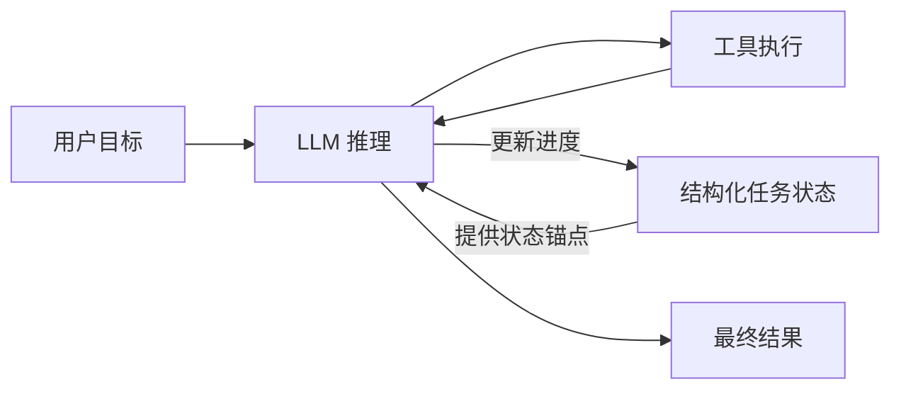

| 机制 | 核心职责 |
| --- | --- |
| Reasoning | 分析问题、制定策略、决定行动 |
| Task Planning | 拆解任务、维护全局目标和执行进度 |
| Context Engineering | 管理模型当前能够获取的信息 |

### 1.2 过度规划

显式规划并不一定提高任务完成质量。

对于简单问答和单步工具调用，规划可能使问题复杂化，增加 Token 消耗、延迟及错误机会。

这种现象称为 Over-planning（过度规划）。

Deep Agents v0.7 不再默认启用 TodoListMiddleware，体现了按需配置的设计思想。

是否启用任务规划，应根据任务复杂度、执行周期和规划收益决定。

## 2. TodoListMiddleware

### 2.1 核心组成

TodoListMiddleware 是 LangChain 提供的任务规划中间件。

| 组成 | 职责 |
| --- | --- |
| `write_todos` | 创建、修改和更新任务清单 |
| `todos` | 保存结构化任务状态 |
| 规划提示词 | 引导模型分解任务与更新进度 |

每个 Todo 包含 content 和 status 两个核心字段。

### 2.2 任务状态

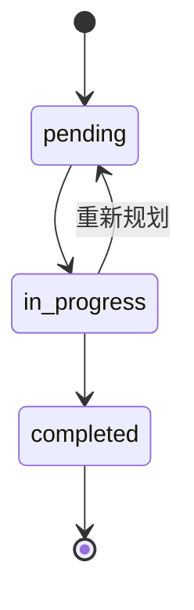

| 状态 | 含义 |
| --- | --- |
| pending | 尚未开始 |
| in_progress | 正在执行 |
| completed | Agent 已将其标记为完成 |

上述状态图表示一种典型的任务生命周期，而不是 TodoListMiddleware 强制约束的状态机。模型可以动态修改任务清单。

### 2.3 状态与真实结果

completed 仅代表 Agent 将任务标记为完成，并不代表任务实际成功或产物正确。

| 可靠性层次 | 核心问题 |
| --- | --- |
| 状态可靠性 | 状态是否反映真实执行情况？ |
| 执行正确性 | 子任务是否产生正确结果？ |
| 规划正确性 | 子任务集合是否能够实现用户目标？ |

即使所有子任务均被正确执行，如果初始规划存在错误，最终结果仍然可能偏离用户需求。

**局部正确性不能保证全局正确性。**

TodoListMiddleware 解决的是任务规划与进度管理问题，而不是任务正确性的保证问题。

## 3. LangChain 底层运行机制

### 3.1 架构分层

Deep Agents 构建于 LangChain 和 LangGraph 之上。

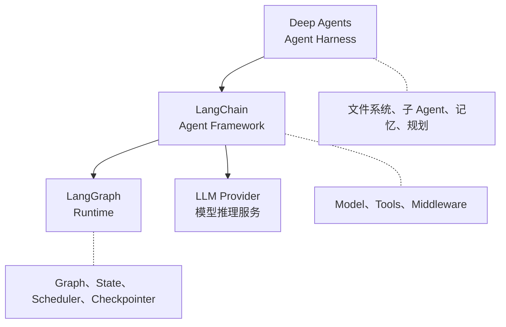

| 层级 | 核心职责 |
| --- | --- |
| Deep Agents | 组装通用 Agent 能力 |
| LangChain | 提供模型、工具、中间件及 Agent 抽象 |
| LangGraph | 图执行、状态管理、调度与持久化 |
| LLM Provider | 模型推理与工具调用生成 |

Deep Agents 并没有重新实现一套完整的 Agent Runtime，而是在现有基础设施上组合通用能力。

### 3.2 Agent Loop

Agent Loop 是 Agent 持续调用模型、执行工具，并根据结果决定下一步行为的核心循环。

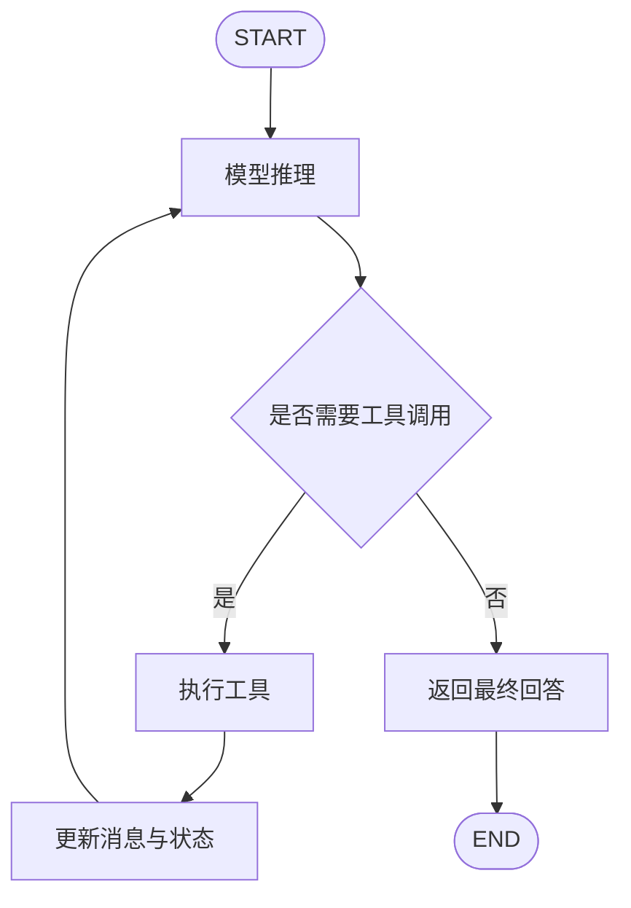

只要模型仍然产生需要执行的工具调用，Agent 通常就会继续循环。这一机制是 LangChain Agent 与 Pi Coding Agent 共同拥有的基础。两者的区别主要在于如何组织、调度和扩展这个循环。

### 3.3 StateGraph

LangChain 的 create_agent 底层会构建并编译 LangGraph 的 StateGraph。

| 元素 | 职责 |
| --- | --- |
| State | 保存 Agent 的结构化运行状态 |
| Node | 执行模型推理、工具执行等操作 |
| Edge | 描述节点间的流转关系 |
| Conditional Edge | 根据状态决定后续节点 |
| Reducer | 定义状态更新的合并方式 |
| Checkpointer | 保存图状态与执行进度 |

LangGraph 的 Graph 不一定是 DAG。Agent Loop 本身就包含循环，而后文讨论的 DAG 任务规划属于应用层任务依赖图，两者是不同的抽象。

### 3.4 Pregel 执行模型

LangGraph 的运行时采用受 Pregel 启发的执行模型。

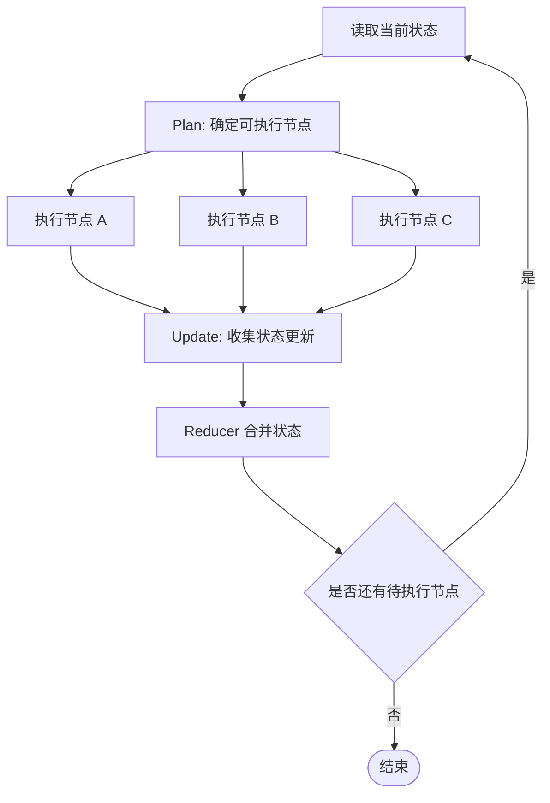

从概念上，每个 Superstep 包含三个阶段：

- Plan：确定当前阶段需要执行的节点。
- Execution：执行可运行节点。
- Update：收集并合并节点产生的状态更新。

同一 Superstep 中具备并行条件的节点可以并行执行，其状态更新在更新阶段统一处理。

**Graph 描述执行路径，Runtime 负责调度，LLM 负责需要智能决策的部分。**

## 4. Middleware 中间件机制

### 4.1 架构定位

Middleware 是 Agent 行为的扩展机制。Checkpointer 是 LangGraph 的运行时基础设施。

前者关注 Agent 如何运行，后者关注 Agent 的状态如何存续。

### 4.2 Node-style Hook

Node-style Hook 作为独立节点参与 Graph 执行，主要包括 before_agent、before_model、after_model、after_agent。

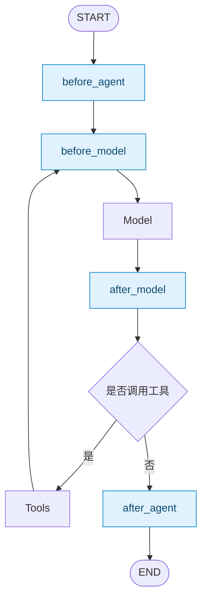

Node-style 更适合独立的状态更新、输入校验、审计、人工审批等任务。

实际 Graph 结构取决于具体中间件配置与条件路由。

### 4.3 Wrap-style Hook

Wrap-style Hook 包裹一次模型或工具调用，主要包括 wrap_model_call 和 wrap_tool_call。

Wrapper 持有 Handler，可以决定调用它零次、一次或多次。多个 Wrap-style Hook 可以构成类似 AOP 的洋葱模型。

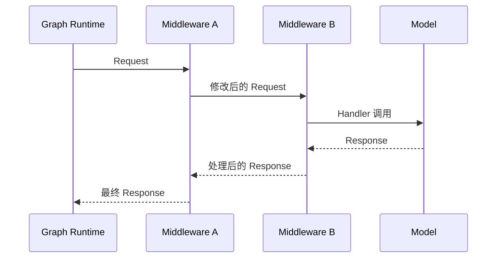

例如，在模型缓存场景中：

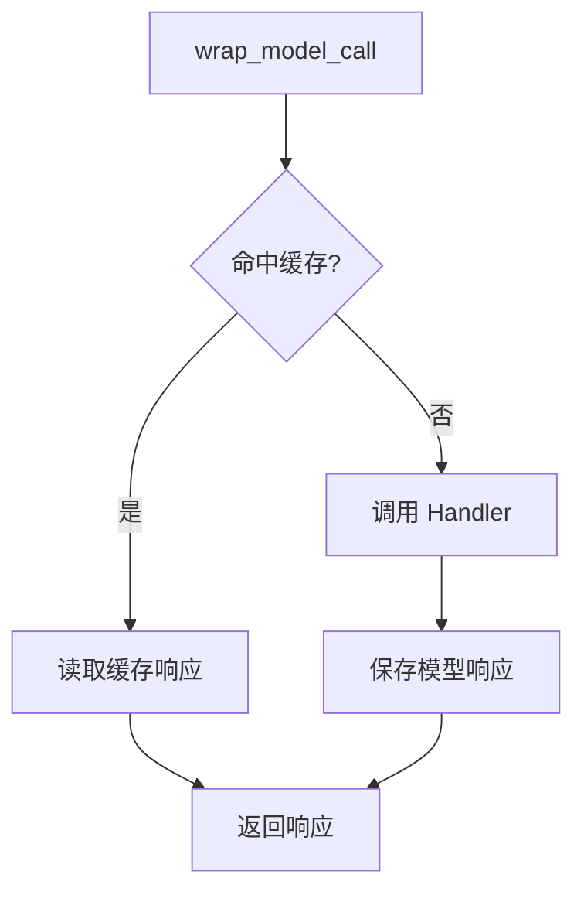

Wrap-style 可以直接替换调用结果，而不必修改 Graph 的主要控制流。

### 4.4 选择的第一性原理

Node-style 与 Wrap-style 的选择，取决于两个因素。

**控制流的所有权**

如果某项功能需要控制一次调用是否执行、执行次数或返回结果，则优先采用 Wrap-style。

**执行边界的独立性**

如果某项功能需要成为独立的工作流阶段，拥有自己的状态更新、审计或中断恢复边界，则优先采用 Node-style。

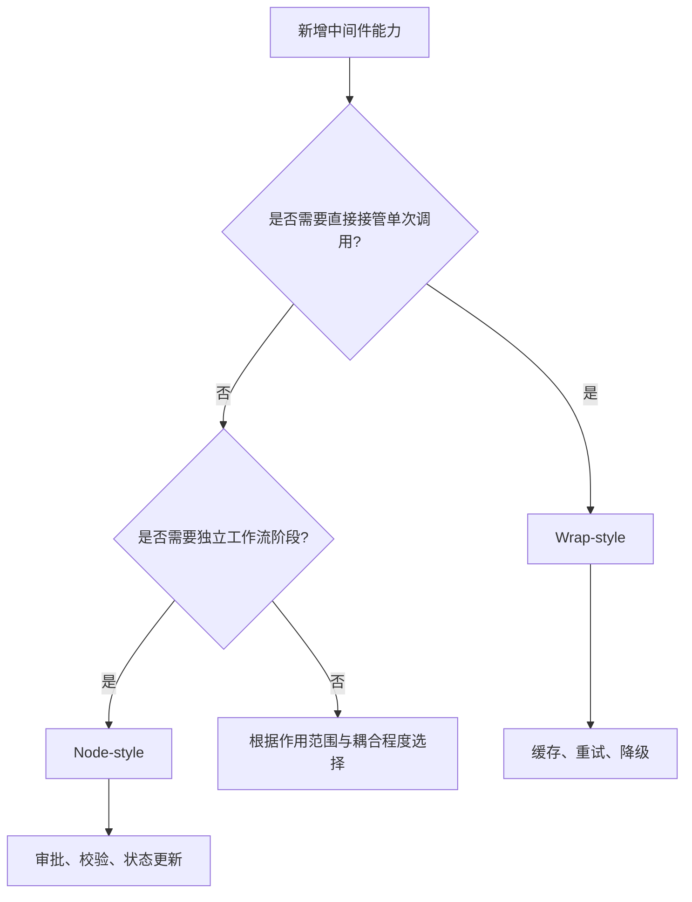

| 维度 | Node-style | Wrap-style |
| --- | --- | --- |
| 设计思想 | 工作流编排 | 装饰器、AOP 环绕增强 |
| 作用粒度 | Graph 节点 | 函数调用 |
| 核心对象 | Agent State | Request、Handler、Response |
| 控制重点 | 阶段流转 | 调用内部行为 |
| 恢复边界 | 独立节点 | 所属节点内部 |
| 典型用途 | 审批、状态更新 | 缓存、重试、降级 |

人工审批优先使用独立节点，还涉及 LangGraph 的恢复机制：从中断恢复时，所在节点会重新执行，因此需要注意重放和副作用。

两种 Hook 并非互斥，可以组合使用。

**Node-style 扩展 Agent 的工作流程，Wrap-style 扩展 Agent 的调用行为。**

### 4.5 中间件组装

Deep Agents v0.7 按配置方式提供三类中间件。

| 配置方式 | 中间件 | 功能 |
| --- | --- | --- |
| 默认提供 | FilesystemMiddleware | 文件工具与权限控制 |
| 默认提供 | SummarizationMiddleware | 上下文压缩 |
| 默认提供 | PatchToolCallsMiddleware | 修补工具响应 |
| 专用参数 | SubAgentMiddleware | 子 Agent 委派 |
| 专用参数 | SkillsMiddleware | 技能注入 |
| 专用参数 | MemoryMiddleware | 记忆注入 |
| 专用参数 | HumanInTheLoopMiddleware | 人工审批 |
| 显式添加 | TodoListMiddleware | 任务规划 |
| 显式添加 | ToolRetryMiddleware | 工具重试 |
| 显式添加 | ModelRetryMiddleware | 模型重试 |
| 显式添加 | ModelFallbackMiddleware | 模型降级 |
| 显式添加 | PIIMiddleware | 隐私信息处理 |

实际启用的中间件还取决于模型、版本和 Harness 配置。

### 4.6 实例替换

Deep Agents 支持通过同名 Middleware 实例替换默认中间件。

替换发生在原有位置，是完整实例替换，而不是逐字段合并。

| 方式 | 优势 | 局限 |
| --- | --- | --- |
| 参数覆盖 | 简单，保留其他默认配置 | 难以扩展复杂行为 |
| 实例替换 | 灵活，支持自定义实现和子类 | 可能遗漏原有配置 |

完整实例替换提供了更高的扩展自由度，同时也将更多配置责任交给开发者。

## 5. Pi Coding Agent 底层架构

> 本节属于课程之外的架构对比。

### 5.1 架构分层

Pi 是一个采用 TypeScript 实现的轻量、可扩展 Agent Harness。

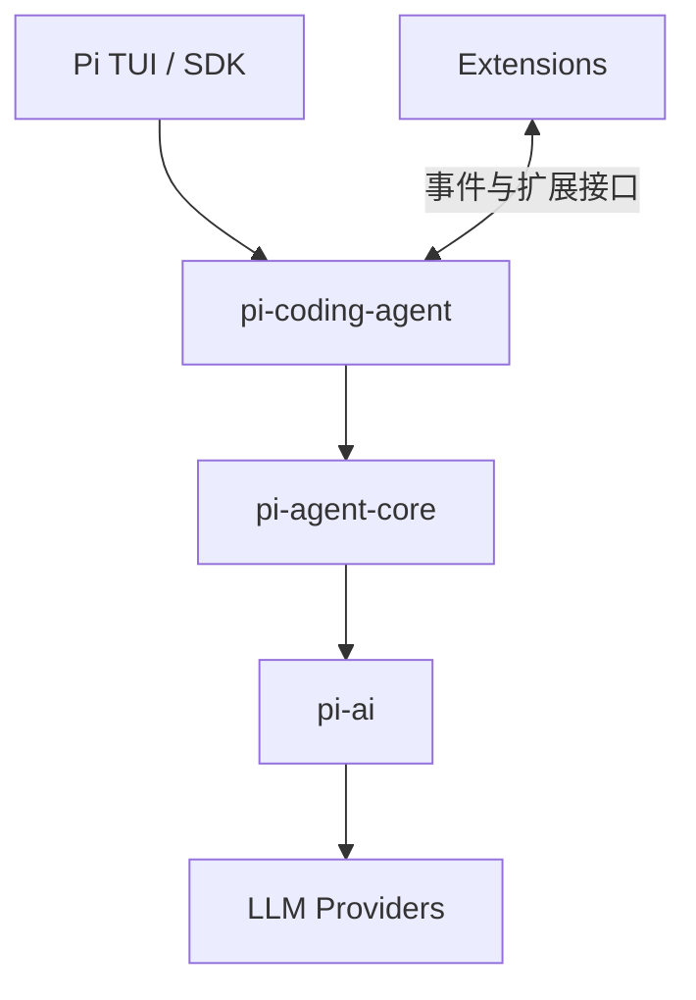

| 组件 | 职责 |
| --- | --- |
| pi-ai | 统一多 Provider 模型 API |
| pi-agent-core | Agent Loop、工具执行、状态与事件流 |
| pi-coding-agent | Coding Agent Harness、会话与扩展管理 |
| pi-tui | 终端交互界面 |

### 5.2 显式 Agent Loop

与 LangChain 将 Agent Loop 组织为 StateGraph 不同，Pi 直接通过异步函数与循环组织模型调用和工具执行。

其核心结构包含两层循环：

| 循环 | 职责 |
| --- | --- |
| 内层循环 | 处理模型响应、工具调用与 Steering 消息 |
| 外层循环 | 当 Agent 原本准备结束时，检查 Follow-up 消息 |

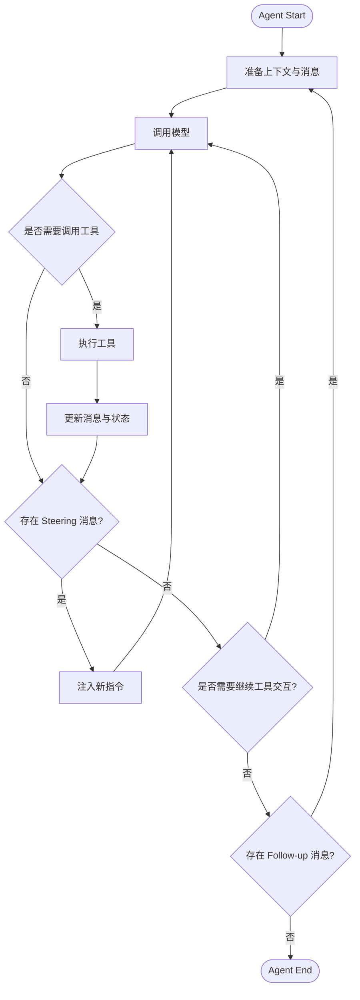

该图省略异常处理、终止条件、部分队列轮询边界及上层会话逻辑。

Pi 的特点不是完全依靠事件来决定下一步执行什么，而是通过显式 Agent Loop 控制主要流程，并在关键生命周期阶段发布事件。

### 5.3 事件驱动扩展

Pi 在运行过程中产生结构化事件，供 UI、Extension 和其他消费者使用。

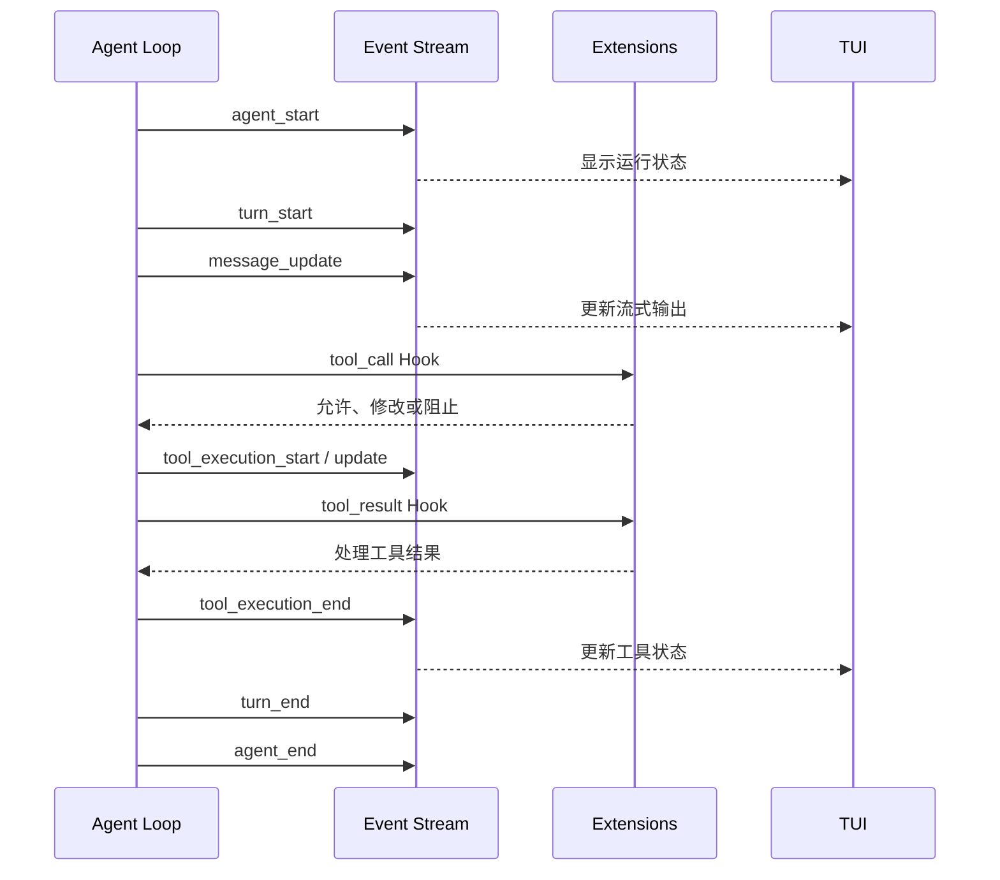

该图将事件通知与可干预 Hook 分开表示，是概念示意，而非精确事件顺序。

| 事件 | 含义 |
| --- | --- |
| agent_start | 底层 Agent 运行开始 |
| turn_start | 一轮模型与工具交互开始 |
| message_start | 消息开始处理 |
| message_update | 流式消息更新 |
| message_end | 消息处理完成 |
| tool_execution_start | 工具开始执行 |
| tool_execution_update | 工具执行进度更新 |
| tool_execution_end | 工具执行结束 |
| turn_end | 当前轮次结束 |
| agent_end | 底层 Agent Loop 结束 |

底层 agent_end 不一定代表整个 Coding Agent 会话已经结束。上层仍可能进行自动重试、上下文压缩或处理后续消息。

### 5.4 Extension 扩展机制

| 扩展事件 | 能力 |
| --- | --- |
| before_agent_start | 修改系统提示词或注入信息 |
| context | 调整模型调用前的上下文 |
| before_provider_request | 检查或替换 Provider 请求 |
| tool_call | 检查、修改参数或阻止工具执行 |
| tool_result | 修改工具返回结果 |
| session_before_compact | 控制上下文压缩 |
| turn_end | 处理轮次边界状态与后续行为 |

部分事件只负责观察运行过程，部分事件则允许修改数据、阻断操作或影响后续控制流。具体接口随 Pi 版本变化。

### 5.5 三种不同层次的循环与事件机制

| 概念 | 职责 |
| --- | --- |
| JavaScript Event Loop | Node.js 的异步任务调度 |
| Agent Loop | 模型调用与工具执行之间的应用层循环 |
| Event-driven Extension | 利用生命周期事件扩展 Agent 行为 |

事件驱动不代表所有事件处理器均并行执行。Pi 的部分处理器会按顺序被等待，以保证处理和修改数据的语义。

因此，更准确的描述是：

**Pi = 显式异步 Agent Loop + 事件驱动扩展机制。**

### 5.6 Steering 与 Follow-up

Pi 支持在 Agent 运行期间注入新指令。

| 机制 | 职责 |
| --- | --- |
| Steering | 在适当的执行边界注入新的用户指令 |
| Follow-up | 当前任务准备结束时继续处理排队任务 |

Steering 不意味着能够任意中断已经执行的外部操作，而是依赖 Agent Loop 的队列与执行边界。

这种机制适合需要持续交互的 Coding Agent。

## 6. LangChain 与 Pi 对比

### 6.1 核心控制流

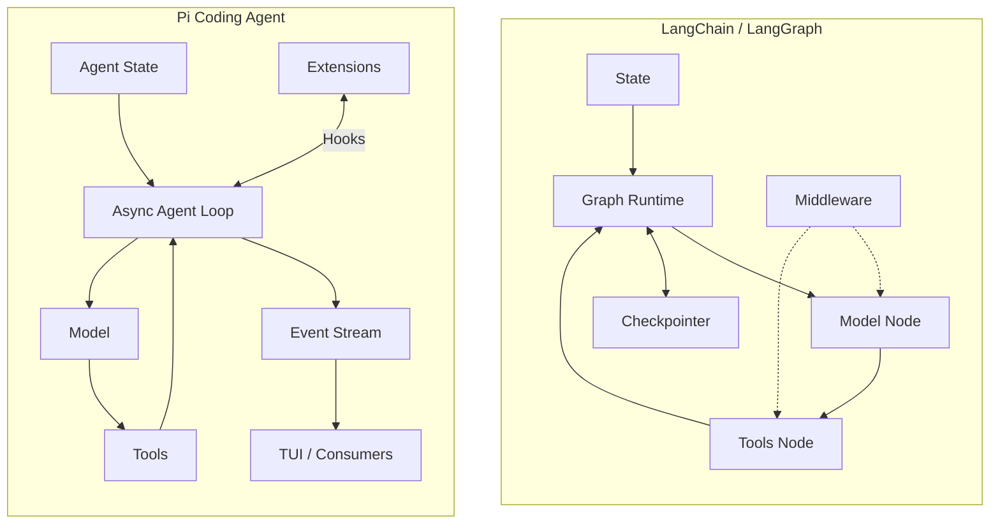

| 维度 | LangChain / LangGraph | Pi Coding Agent |
| --- | --- | --- |
| 核心控制流 | StateGraph | 显式异步循环 |
| 扩展机制 | Middleware、Node、Edge | Event Hook、Extension |
| 状态管理 | State Schema、Reducer | Agent State、会话状态 |
| 执行调度 | Graph Runtime | Agent Loop 内部逻辑 |
| 持久化 | Checkpointer、Store | 会话持久化与扩展记录 |
| 动态干预 | 条件路由、Interrupt | Steering、Follow-up |
| 可观测性 | Streaming、Graph State、Trace | 生命周期事件流 |
| 设计取向 | 通用、结构化、可编排 | 轻量、开放、交互式 |

两者并不是完全对立的架构。LangGraph 同样支持事件流，Pi 同样管理状态。区别在于核心执行控制流的组织方式，以及框架提供给开发者的首要抽象。

### 6.2 Hook 对比

| LangChain | Pi 中近似的扩展点 |
| --- | --- |
| before_agent | before_agent_start |
| after_agent | agent_end 等结束阶段事件 |
| before_model | context、请求前处理 |
| after_model | message_end 等消息阶段事件 |
| wrap_tool_call | tool_call、tool_result |
| SummarizationMiddleware | 上下文压缩相关事件 |

上述仅为功能上的近似映射，并非严格等价。

LangChain 的 Wrap-style 持有 Handler，可以控制被包装调用的执行次数；Pi 的事件 Hook 则通过各自定义的返回协议影响行为。

### 6.3 架构取舍

Graph 驱动适合：

- 具有明确阶段、分支与执行约束的工作流。
- 需要持久化状态与中断恢复的任务。
- 需要明确表达并行关系的系统。
- 多组件协作与结构化任务编排。

显式 Agent Loop 适合：

- 以模型自主决策为主的开放任务。
- 需要实时流式交互的 Coding Agent。
- 希望保持核心运行机制简单的 Harness。
- 需要通过 Extension 快速扩展能力的应用。

选择的关键不是哪一种架构更加先进，而是系统需要多强的执行约束、恢复能力与交互灵活性。

## 7. 状态持久化

### 7.1 状态分离

Todo 清单保存在 Agent State 的独立 todos 字段中，而不是仅存在于历史消息中。

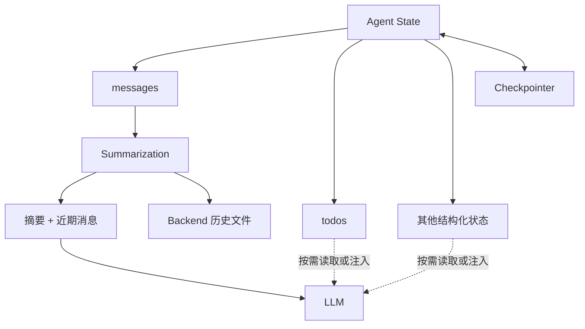

默认的上下文摘要不会删除 todos 字段。独立 State 字段不会自动出现在模型输入中，需要由中间件、工具或其他上下文构造机制提供。

### 7.2 Checkpointer

Checkpointer 属于 LangGraph 的运行时持久化机制，而不是 Middleware。

| 场景 | 恢复能力 |
| --- | --- |
| 单次运行 | 当前运行状态可用 |
| 多次调用，无 Checkpointer | 不保证自动接续 |
| InMemorySaver + 相同 thread_id | 当前进程内恢复 |
| 持久化 Checkpointer + 相同 thread_id | 跨进程恢复已保存的检查点 |
| 新 thread_id | 不自动继承原线程状态 |

默认情况下，子 Agent 不会继承主 Agent 的 TodoListMiddleware；各自的 Todo 清单也不会自动共享。

### 7.3 恢复与执行一致性

内部状态恢复不等于外部环境恢复。

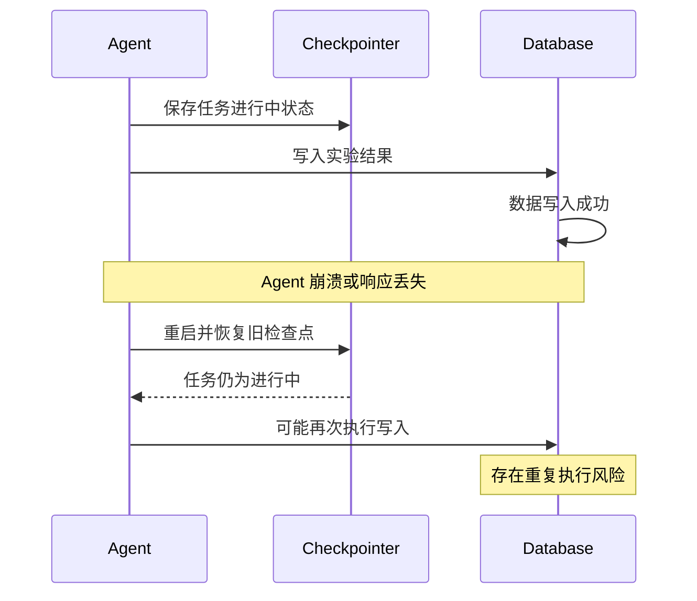

**状态恢复不等于执行一致性。**

可靠的长程 Agent 仍需要外部状态核验、操作幂等性及执行记录。

相比之下，Pi 的会话持久化主要服务于对话历史恢复和后续交互，并不等价于 LangGraph 的节点级工作流恢复。

## 8. 上下文管理

### 8.1 摘要中间件对比

LangChain 和 Deep Agents 都提供 SummarizationMiddleware，但执行语义有所不同。

| 维度 | LangChain | Deep Agents |
| --- | --- | --- |
| Hook 类型 | Node-style | Wrap-style |
| 执行位置 | before_model | wrap_model_call |
| 原始消息 | 旧消息被替换为摘要 | 正常摘要时保留原始消息 |
| 模型输入 | 摘要与近期消息 | 摘要与近期消息 |
| 历史文件 | 不负责写入 Backend | 保存待总结历史 |
| Graph 可见性 | 独立摘要节点 | 位于 model 节点内部 |

Deep Agents 通过修改本次模型请求实现上下文压缩，同时记录摘要及截断位置。

文件系统和摘要中间件需要使用一致的 Backend，才能回读保存的历史。

模型窗口已知时，create_deep_agent 通常采用 85% 的默认触发比例。手动实例化时需要关注触发条件及保留策略。

Deep Agents 还可以在上下文溢出异常发生时尝试摘要并重试。

### 8.2 状态锚点

Todo 可以作为长程任务的 State Anchor。但 Todo 不能充分保留研究假设、决策依据、用户约束和证据细节。

**任务进度的连续性不等于认知过程的连续性。**

## 9. 工具执行可靠性

### 9.1 PatchToolCallsMiddleware

PatchToolCallsMiddleware 负责修复工具调用消息历史的结构完整性。

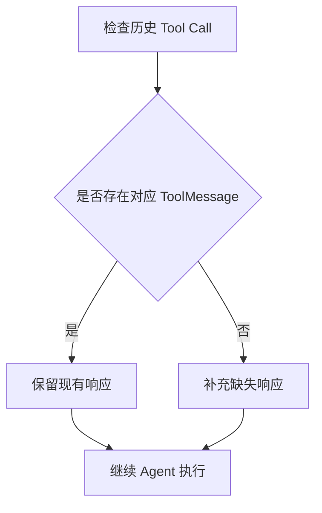

它不会重新执行工具，也不会验证实际执行结果。补充的错误或取消响应，不能证明外部操作没有发生。

### 9.2 机制职责边界

| 机制 | 职责 |
| --- | --- |
| PatchToolCallsMiddleware | 修补缺失响应 |
| ToolRetryMiddleware | 根据策略重试工具异常 |
| Checkpointer | 保存与恢复运行状态 |
| 结果验证机制 | 检查实际产物是否正确 |

消息完整性、实际执行状态与结果正确性是三个不同层次的问题。

### 9.3 幂等性

幂等性（Idempotency）指同一个逻辑操作重复执行多次，其预期效果与执行一次相同。

例如，将字段设置为固定值通常具有幂等性，而将字段增加固定数值通常不具有幂等性。

数据库事务的原子性不能自动保证重复执行安全。

对于具有副作用的操作，可以通过唯一 operation_id、数据库唯一约束和事务等机制实现重复执行保护。

**网络超时不代表操作失败，没有收到响应也不代表操作没有执行。**

## 10. 个人思考与架构扩展

> 以下内容来自课程学习与苏格拉底式讨论，并非 Deep Agents 或 Pi 的内置功能。

### 10.1 验证驱动规划

更加可靠的规划系统应在制定计划时定义 Acceptance Criteria，并进行局部验证和全局验证。

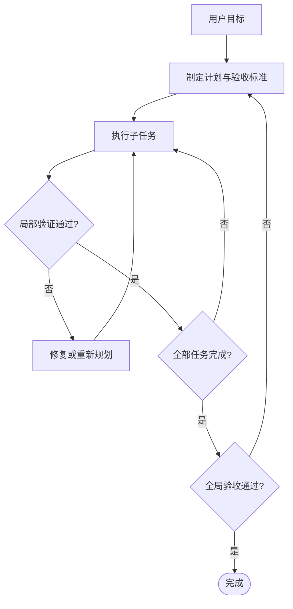

客观指标应优先使用确定性程序验证，开放性的语义质量则可使用独立 LLM Judge、Rubric 或人工审核。

### 10.2 工具执行状态机

工具执行状态不能只保存在工具返回值中，因为响应本身可能丢失。

可以通过独立的持久化执行记录管理状态。

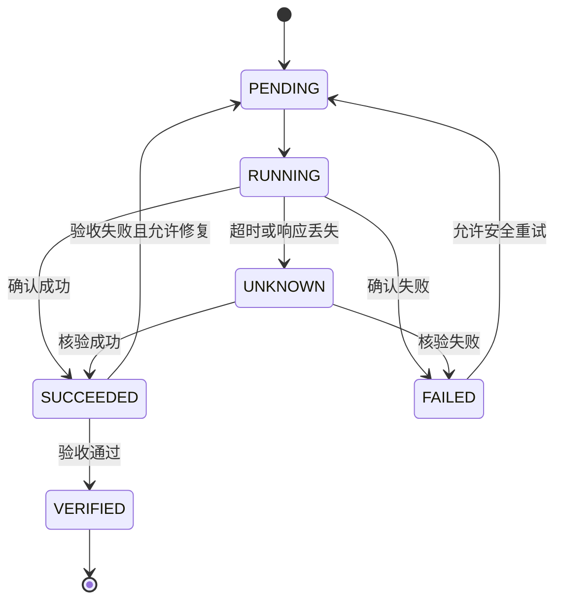

| 状态 | 含义 |
| --- | --- |
| PENDING | 尚未执行 |
| RUNNING | 正在执行 |
| FAILED | 确认失败 |
| UNKNOWN | 无法确认结果 |
| SUCCEEDED | 确认执行成功 |
| VERIFIED | 产物通过验收 |

UNKNOWN 尤其重要。当执行状态未知时，应优先核验外部状态，而不是直接重试。

### 10.3 多维状态管理

为了避免上下文压缩造成的信息丢失，可以独立管理五类状态。

| 类型 | 保存内容 |
| --- | --- |
| 目标状态 | 用户意图、任务约束、验收标准 |
| 规划状态 | Todo、任务依赖、执行进度 |
| 认知状态 | 研究假设、决策依据、未解决问题 |
| 产物状态 | 文件、证据、验证结果 |
| 环境状态 | 当前路径、Shell 会话、进程、资源占用 |

环境状态具有时效性，需要通过查询获取真实信息。

可以通过类似 Pi 状态栏的设计动态展示环境信息，并通过独立接口向模型提供必要的当前状态。

UI 状态栏与模型上下文不是同一个机制。

### 10.4 DAG 任务规划

普通 TodoList 缺少显式任务依赖关系，难以支持复杂任务的并行调度与动态重规划。

可以将任务规划扩展为 DAG（Directed Acyclic Graph，有向无环图）。

| 字段 | 职责 |
| --- | --- |
| id | 唯一标识 |
| content | 任务描述 |
| status | 任务状态 |
| dependencies | 上游依赖 |
| conclusion | 可复用结论 |
| artifacts | 产物路径与证据引用 |
| acceptance_criteria | 验收标准 |
| verification | 验证结果与依据 |
| revision | 任务版本 |

conclusion 用于快速理解任务成果，artifacts 用于回查原始信息与验证结论。

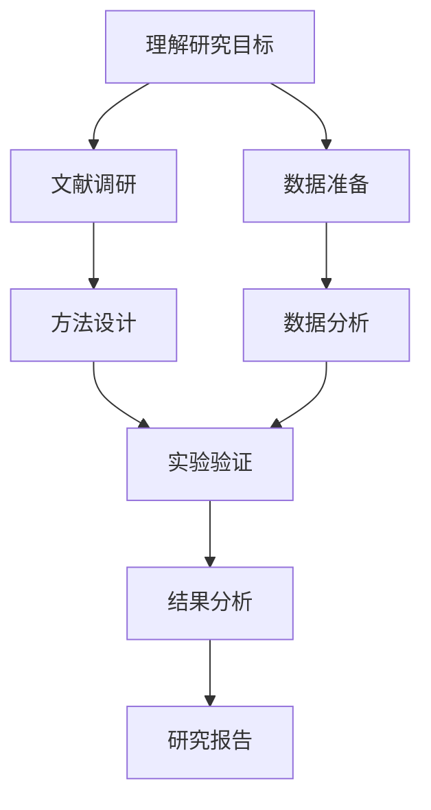

显式依赖关系能够支持并行调度、依赖阻塞、动态重规划、成果复用与失效传播。

### 10.5 动态重规划与失效传播

当上游研究假设被推翻时，不应无条件丢弃所有已完成任务。

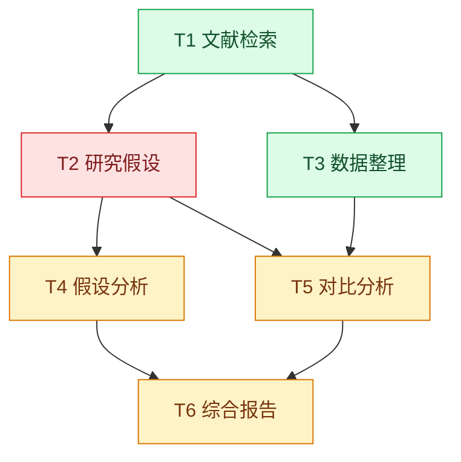

- 绿色：仍然有效，可以复用。
- 红色：研究假设错误，需要修改。
- 黄色：受上游影响，需要重新验证或执行。

这种机制类似软件工程中的增量构建与 Cache Invalidation。

**计划可以重构，但已有成果不应被无条件丢弃。**

## 11. 综合架构设计

### 11.1 混合驱动架构

结合 LangGraph 与 Pi 的设计思想，可以构建一种混合驱动的长程科研 Agent。

```mermaid
flowchart TD
    U[用户目标] --> P[Planner Agent]
    subgraph O["确定性编排层"]
        D[DAG Scheduler]
        S[State Manager]
        C[Checkpointer]
        D <--> S
        S <--> C
    end
    P --> D
    subgraph W["自主执行层"]
        W1[Worker Agent 1]
        W2[Worker Agent 2]
        W3[Worker Agent 3]
    end
    D --> W1
    D --> W2
    D --> W3
    W1 --> V[Verifier Agent / 程序校验]
    W2 --> V
    W3 --> V
    V --> R{验证通过?}
    R -->|是| S
    R -->|否| P
    S --> F{全局目标达成?}
    F -->|否| D
    F -->|是| E[最终交付]
    W1 <--> B[Backend]
    W2 <--> B
    W3 <--> B
    V <--> B
    D -.-> EB[Event Bus]
    W1 -.-> EB
    W2 -.-> EB
    W3 -.-> EB
    V -.-> EB
    EB --> UI[UI、监控与用户干预]
```

整个系统包含三个主要机制：

- 外层 Graph / DAG：全局任务编排、依赖调度与状态恢复。
- 内层 Agent Loop：开放性推理、工具调用与动态决策。
- 横向 Event Bus：进度通知、监控与交互扩展。

关键状态仍然需要由可信的 State Manager 管理，不能只依赖事件通知作为持久化依据。

### 11.2 多 Agent 职责分离

| 组件 | 职责 |
| --- | --- |
| Planner | 理解目标、制定计划与动态重规划 |
| Scheduler | 依赖检查、任务分发与并发调度 |
| Worker | 执行具体研究任务 |
| Verifier | 独立验证任务成果 |
| State Manager | 状态转移与持久化 |
| Backend | 文件、证据与长期记忆 |
| Event Bus | 进度通知、监控与交互 |

规划、执行和验证分离，可以通过上下文隔离降低确认偏差。

但不同 Agent 仍然可能具有共同的认知盲区，因此确定性程序验证优先于 LLM Judge。

### 11.3 概率性智能与确定性工程

| 职责 | 负责组件 |
| --- | --- |
| 用户意图理解 | LLM |
| 任务规划 | LLM |
| 开放性研究与分析 | LLM |
| 动态重规划 | LLM |
| DAG 合法性检查 | 确定性程序 |
| 任务依赖与并发调度 | 确定性程序 |
| 状态转移与持久化 | 确定性程序 |
| 权限与资源控制 | 确定性程序 |
| 客观结果验证 | 确定性程序 |
| 主观质量评价 | 独立 LLM / 人工 |

LLM 可以提出任务计划和状态转移请求，但程序应根据依赖关系、执行记录与验收条件判断请求是否允许执行。

**能够通过明确规则可靠解决的问题，优先交给确定性程序；需要语义理解、开放性推理与动态决策的问题，交给 LLM。**

## 12. 总结

| 核心主题 | 设计原则 |
| --- | --- |
| 任务规划 | 全局状态与模型推理解耦 |
| 任务验证 | 局部正确不代表全局正确 |
| Middleware | 控制流所有权与执行边界 |
| Graph Runtime | 结构化编排、状态管理与调度 |
| Agent Loop | 开放性推理与自主执行 |
| Event-driven | 生命周期感知与组件解耦 |
| Checkpointer | 状态恢复不代表执行一致 |
| DAG Planning | 依赖管理与增量复用 |
| Agent Harness | 概率性智能与确定性工程分离 |

第三章解决 Agent 如何管理信息，第四章解决 Agent 如何管理任务与组织执行流程。

最终可以将混合架构概括为：

**Graph 管全局，Loop 管局部，Event 管交互，State 管事实，LLM 管决策。**

## 参考资料

### 课程

- [DeepAgents In Action 第四章](https://github.com/datawhalechina/deepagents-in-action/blob/main/content/ch04-task-planning.md)
- [Deep Agents 官方文档](https://docs.langchain.com/oss/python/deepagents/overview)

### LangChain / LangGraph

- [LangChain Middleware](https://docs.langchain.com/oss/python/langchain/middleware/overview)
- [LangChain Agent Factory](https://github.com/langchain-ai/langchain/blob/master/libs/langchain_v1/langchain/agents/factory.py)
- [LangGraph Graph API](https://docs.langchain.com/oss/python/langgraph/graph-api)
- [LangGraph Pregel](https://docs.langchain.com/oss/python/langgraph/pregel)
- [LangGraph Persistence](https://docs.langchain.com/oss/python/langgraph/persistence)

### Pi Coding Agent

- [Pi 官方仓库](https://github.com/earendil-works/pi)
- [Pi Agent Core](https://github.com/earendil-works/pi/tree/main/packages/agent)
- [Agent Loop 源码](https://github.com/earendil-works/pi/blob/main/packages/agent/src/agent-loop.ts)
- [Pi Extensions](https://github.com/earendil-works/pi/blob/main/packages/coding-agent/docs/extensions.md)
